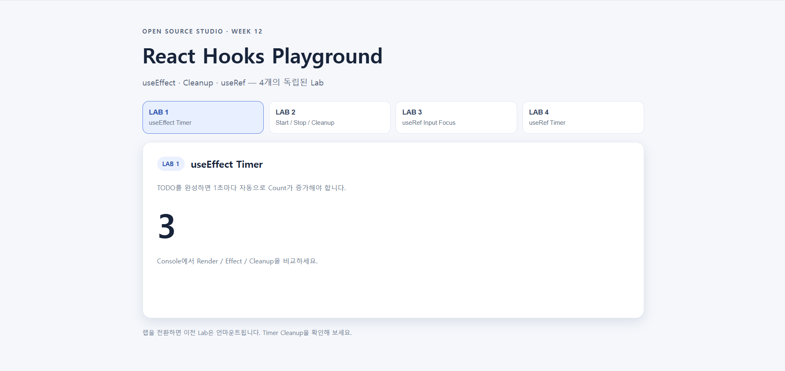
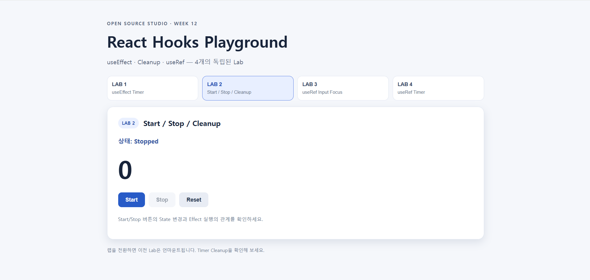
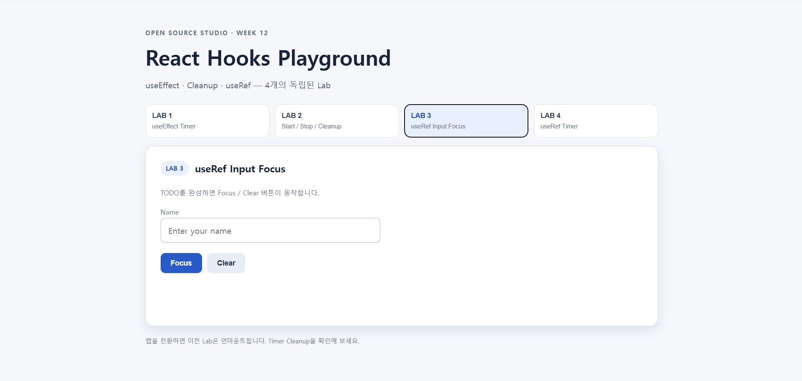
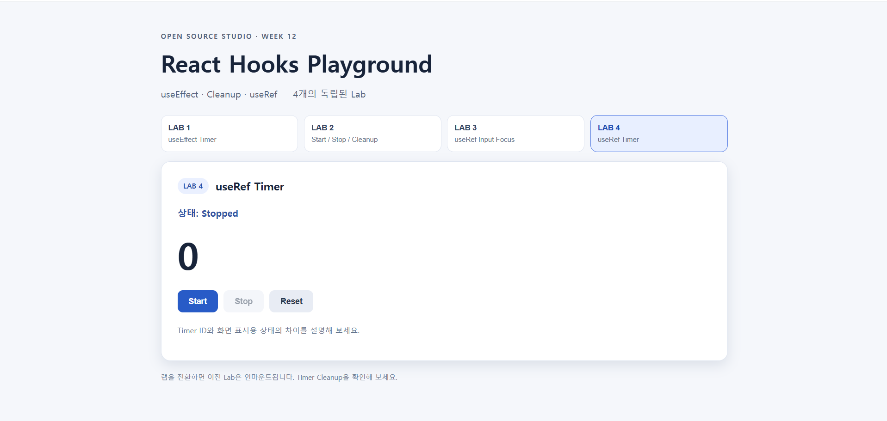

# OSS Week 12 — React Hooks Playground (Student Starter)

22300060 길민성

## Project Information
### 프로젝트 소개 및 Starter Project 정보
- 이 프로젝트는 useEffect, Cleanup, useRef를 4개의 독립된 Lab으로 실습하는 웹이다. 
- 원본 Starter Project URL: https://github.com/2026-2-OSS/week12_starter_project
- React + Vite로 구성되어 있다.

## 실행 방법
Node.js 20.19+ 또는 22.12+ 권장. 프로젝트 폴더에서 실행:

```bash
npm install
npm run dev
```

브라우저에 터미널의 Local URL을 열고 LAB 탭을 이동하세요. 제출 전 `npm run build`도 실행하세요.

## 수행 방법
1. `src/components/` 아래의 LAB 1~4 파일에 있는 `TODO`를 직접 완성합니다.
2. `src/App.jsx`, `src/App.css`는 공통 화면이므로 가급적 수정하지 않습니다.
3. 각 LAB의 동작 화면과 콘솔 결과를 기록합니다.
4. 한 LAB에서 다른 LAB으로 탭을 전환하면 기존 컴포넌트가 언마운트됩니다. Cleanup 결과를 관찰합니다.

## 실행 화면

### LAB 1


## Source Code Exploration
### 주요 파일 구조
- `Lab1_EffectTimer.jsx`: useEffect을 사용한 자동으로 증가하는 타이머다.
- `Lab2_TimerControl.jsx`: running State에 따라 useEffect가 타이머를 관리한다.
- `Lab3_InputFocus.jsx`: useRef를 이용하여 DOM에 접근해서 Focus, Clear 기능을 만든다.
- `Lab4_RefTimer.jsx`: useRef에 타이머 ID를 보관하고, Event Handelr에서 타이머를 직접 제어한다.
- `main.jsx`: App을 렌더링하고, StrictMode로 감싼다.
- `App.jsx`: Lab 목록을 배열로 만들고, 현재 보고있는 목록을 관리한다.
### useEffect 및 useRef 분석
1. `useEffect 분석`
- useEffect가 실행된다고 화면이 다시 그려지지는 않고, 안에서 setCount처럼 State를 바꿨을 때만 다시 그려진다.
- LAB 1, 2에서는 useEffect에서 타이머를 만들고, Cleanup에서 clearInterval로 정리해서 탭을 옮겨도 타이머가 남지 않게 했다.
2. `useRef 분석`
- 렌더링이 다시 되어도 사라지지 않는 값을 넣어두는 상자라고 이해했다. 값은 current에 들어 있다.
- current를 바꿔도 화면이 다시 그려지지 않아서, 화면에 보여줄 필요가 없는 값을 저장할 때 쓴다.

### 주요 코드 설명
1. `Lab 2_TimerControl.jsx`
- running이 바뀔 때마다 useEffect가 다시 실행된다.
- running이 true면 setInterval로 1초마다 count를 1씩 올린다.
- Stop을 눌러 running이 false가 되면 clearInterval이 먼저 실행되어 타이머가 멈춘다.

2. `Lab 4_RefTimer.jsx`
- start: 타이머 ID를 timerRef.current에 저장한다. 이미 값이 있으면 바로 return한다.
- stop: clearInterval(timerRef.current)로 타이머를 멈추고 timerRef.current를 null로 되돌린다.
- 화면에 보이는 count, running은 State로, 보이지 않는 타이머 ID는 useRef로 관리한다.

## Lab Implementation
1. `Lab1_EffectTimer`
- useEffect(fn, []) 안에서 setInterval로 1초마다 setCount(prev => prev + 1)을 실행하고, 타이머 id를 보관한다. clearInterval(id)를 호출해서 다른 탭으로 이동하면 타이머가 남지 않게한다.
- 실행 결과: Count가 1초마다 자동으로 1씩 증가한다.


2. `Lab2_TimerControl`
- running이 바뀔 때마다 useEffect가 다시 실행된다.
- running이 true면 setInterval로 1초마다 count를 1씩 올린다.
- Stop을 눌러 running이 false가 되면 clearInterval이 먼저 실행되어 타이머가 멈춘다.
- 실행 결과: Start를 누르면 상태가 Running으로 바뀌고 카운트가 올라가고, Stop을 누르면 상태가 Stopped로 바뀌고 카운트가 멈추고, Reset을 누르면 0으로 돌아간다.



3. **LAB 3 — useRef Input Focus**
- useRef(null)로 inputRef를 만들고 input에 ref={inputRef}를 연결한다. Focus 버튼은 inputRef.current.focus()를 호출하고, Clear 버튼은 inputRef.current.value를 빈 문자열로 바꾼 뒤 다시 focus()를 호출한다.
- 실행 결과: Focus를 누르면 입력창에 커서가 생기고, Clear를 누르면 입력한 이름이 지워지고 입력창에 포커스된다.



4. **LAB 4 — useRef Timer**
- start: 타이머 ID를 timerRef.current에 저장한다. 이미 값이 있으면 바로 return한다.
- stop: clearInterval(timerRef.current)로 타이머를 멈추고 timerRef.current를 null로 되돌린다.
- 화면에 보이는 count, running은 State로, 보이지 않는 타이머 ID는 useRef로 관리한다.
- 실행 결과: LAB 2랑 똑같이 Start, Stop, Reset이 동작하지만, 타이머를 Effect가 아니라 Event Handler에서 관리한다.



## Lab Comparison
1. `setCount(prev => prev + 1)`은 왜 유용한가?  
`setCount(count + 1)`은 최초 렌더링의 count값만을 사용하기 때문에 반복적으로 1만 출력한다. 하지만 `setCount(prev => prev + 1)`을 실행하면 이전 state의 값을 사용해서 다음 state를 계산하기 때문에 정상적으로 1 -> 2 -> 3 -> 4가 출력된다.
2. `useEffect(fn, [])`과 `useEffect(fn)`은 어떻게 다른가?
`useEffect(fn, [])`은 최초 마운트 시에만 실행이 되고, `useEffect(fn)`은 컴포넌트가 커밋될 때 실행된다.
3. Cleanup은 언제 실행되는가? 개발 환경 StrictMode 영향은?
useEffect가 다시 실행되기 전, 컴포넌트가 사라질 때 실행된다. strictmode에서 cleanup기능의 동작을 확인하기 위해서 effect를 마운트하고 cleanup을 실행하고 재마운트를 해서 effect가 두 번 실행된다.
4. `useState`와 `useRef`의 값 변경 시 렌더링 차이는?
`useState`는 값이 변경되면 랜더링하지만 `useRef`는 값이 변경되어도 다시 렌더링을 하지않는다.
5. LAB 2와 LAB 4에서 Timer를 관리하는 방식의 차이는?
Lab 2에서는 useEffect가 state변화에 따라서 타이머를 관리한다. 하지만 Lab 4에서는 event handler가 타이머를 직접 제어하고 useRef에서 id를 보관한다.

## Customizing
1. `App.jsx`
- 프로젝트 제목을 `React Hooks Playground`에서 `My Timer & Input Focus`으로 바꿨다.

2. `App.css`
- Lab 버튼의 배경색을 파란색에서 민트색으로 바꿨다.
- 카운트 숫자의 크기를 64px에서 130px로 키웠다.

3. `동작 확인`
- 4개 Lab 모두 수정 전이랑 똑같이 정상 동작하는 것을 확인했다.

## Deployment
Vercel URL: https://2026-oss-assign12-good.vercel.app/

## Weekly Review
### 새롭게 배운 내용
- 이전 state값을 이용해서 계산해야할 때는 prev => prev + 1을 사용해야한다는 것을 배웠다.
- Cleanup으로 타이머를 정리해야 탭을 옮겨도 타이머가 남지 않는다는 것을 배웠다.
- useRef는 값이 바뀌어도 다시 렌더링되지 않는다는 것을 배웠다.

### 어려웠던 점과 해결 방법
- LAB 4에서 setRunning을 빼먹어서 상태 표시가 안 바뀌었다. useRef는 화면을 다시 그리지 않으니 running은 State로 바꿔야 한다는 걸 알고 추가했다.

### AI 활용 내용 및 느낀 점
- 헷갈리는 개념을 AI에게 물어봤다. 정답보다 이유를 듣고 직접 고치는 게 이해에 더 도움이 되었다.